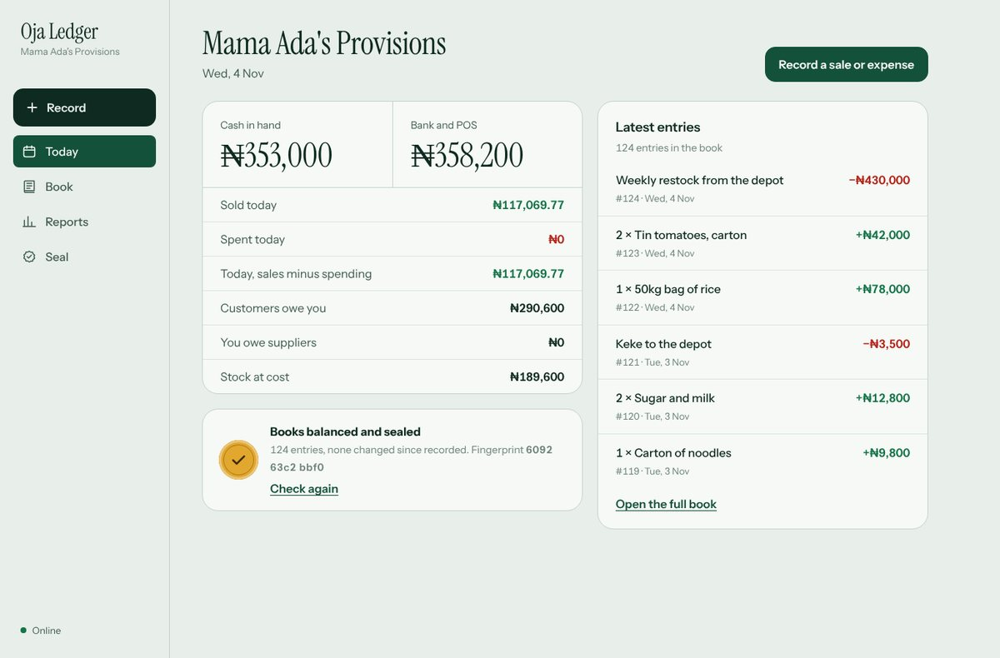
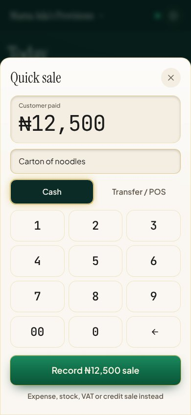
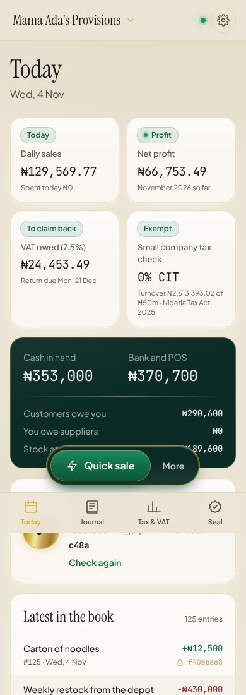
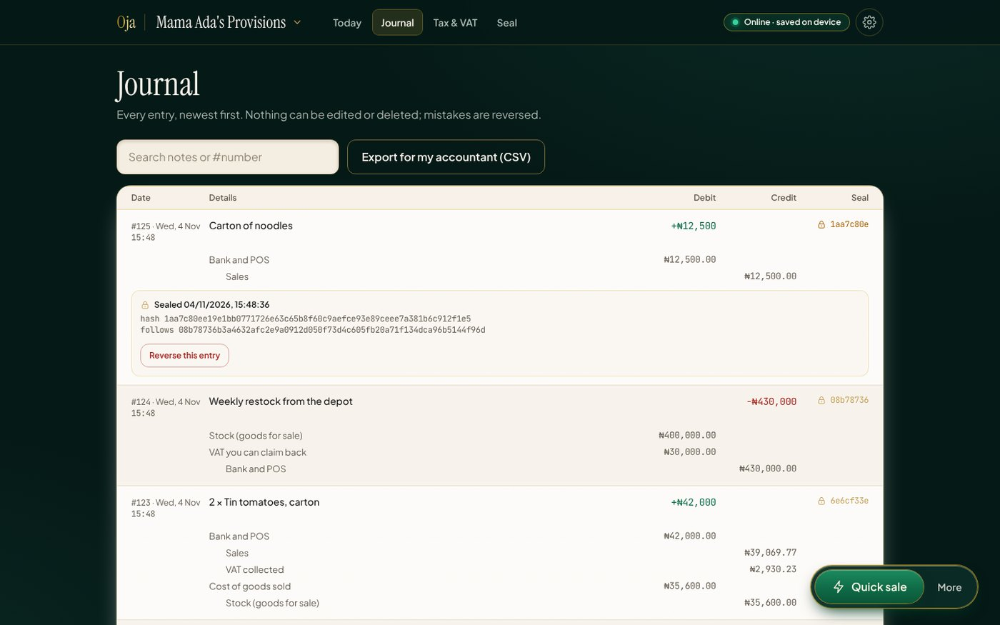
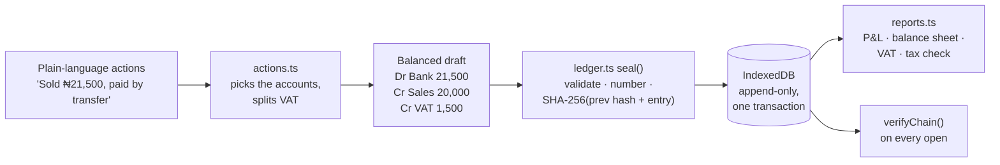
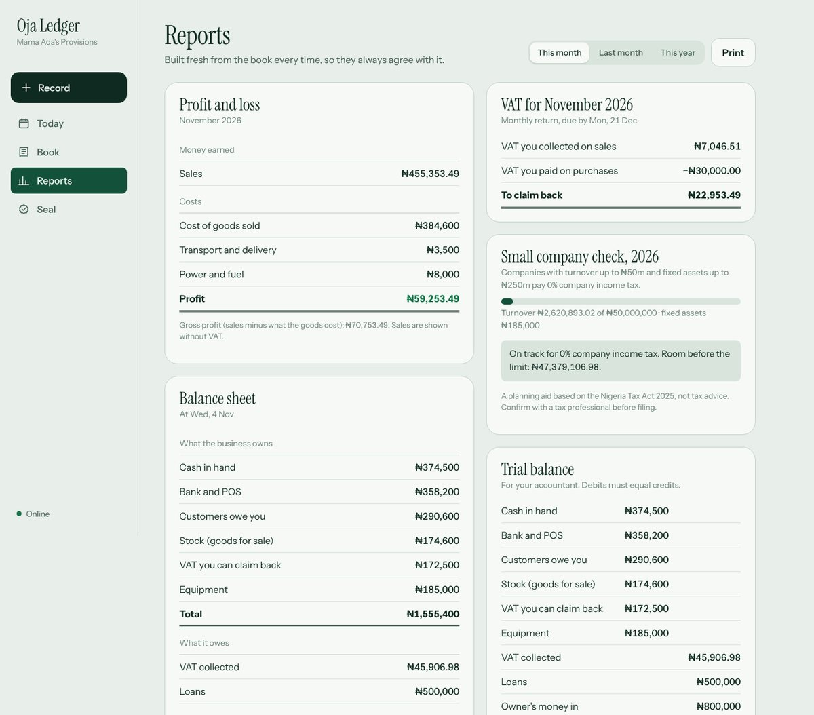

# Oja Ledger

[](https://github.com/peterafolabi-dev/oja-ledger/actions/workflows/ci.yml)


**Offline double-entry bookkeeping for Nigerian small businesses.** Record a sale in two taps on a phone with no network, and get a profit and loss, balance sheet, monthly VAT return and small-company tax check that always agree with each other, to the kobo.

> "Oja" is Yoruba for *market*.

**▶ Live demo:** [oja-ledger.vercel.app](https://oja-ledger.vercel.app). Tap **Explore a sample shop** to load a month of a real-looking provisions store. No sign-up; everything stays on your device.



---

## Why this exists

Most market traders keep books in an exercise book, or not at all. That means no idea of real profit, VAT surprises, and nothing to show a bank or the tax office. Accounting apps exist, but they assume steady internet, a laptop and an accountant's vocabulary.

Oja Ledger is built for the person at the stall:
- **It works offline.** The whole book lives on the phone and the app installs from the browser.
- **It speaks plainly.** "Customer will pay later", not "accounts receivable". The debits and credits are there, one tap away, for anyone who wants to see them.
- **It can't quietly go wrong.** That's the engineering part, below.

## What makes it different

| | What it means | How it's enforced |
|---|---|---|
| **Double-entry, always** | Every entry moves money from somewhere to somewhere. Debits equal credits. | `validateDraft()` rejects anything that doesn't balance, plus **property-based tests** that throw 800 random trading histories at the engine on every push and check the books still balance. |
| **Money is never a float** | ₦0.10 + ₦0.20 is exactly ₦0.30. | All amounts are integer kobo behind a branded `Kobo` type. VAT splitting is tested to never create or lose a kobo, for every amount up to ₦100bn. |
| **Tamper-evident** | Changing any past entry is detectable. | Each entry stores a **SHA-256 hash** of its contents plus the previous entry's hash, a hash chain. The app re-verifies the whole chain on open and shows a short fingerprint you can give your accountant. |
| **Append-only** | Nothing is edited or deleted. | Mistakes are fixed with **reversal entries**. A property test proves a reversal returns every account exactly to where it was. |
| **Atomic saves** | A crash mid-save never leaves half an entry. | Entries and the chain head are written in one IndexedDB transaction, tested with `fake-indexeddb`. |
| **PIN login and lock** | Only the owner opens the book; “Lock” logs out, and it re-locks after 5 minutes away. | The PIN is never stored: a salted **PBKDF2-SHA-256** hash (150,000 iterations) is checked with a constant-time compare, with a cooldown after 5 wrong tries. |
| **Offline-first** | Opens and saves with no network. | A service worker caches the app shell; the book is in IndexedDB, not on a server. |
| **2026 tax rules** | 7.5% VAT returns due by the 21st, and the small-company test (≤ ₦50m turnover, ≤ ₦250m fixed assets → 0% CIT) under the Nigeria Tax Act 2025. | Rates live in one file (`src/core/tax.ts`) with tests for the edge cases. |

<p>
  
  &nbsp;
  
</p>



### Design: "Warm Tactile Ledger Luxury"
The look borrows from a leather-bound accounting ledger and the precision of modern fintech: a deep forest-green shell, parchment pages edged in brushed brass, Instrument Serif headings, Plus Jakarta Sans for the interface and JetBrains Mono for every naira amount so columns line up. Design tokens live in `tailwind.config.js` and `src/styles.css` as CSS variables, so the dark "leather" and light "parchment" themes share one set of classes.

## How it works



The core (`src/core/`) is plain TypeScript with no React and no browser APIs except Web Crypto, so it runs the same in the app, in tests and, later, on a server.

```
src/
├── core/            the accounting engine (framework-free)
│   ├── money.ts         integer kobo, parsing, VAT split
│   ├── accounts.ts      chart of accounts in plain language
│   ├── ledger.ts        validation, hash chain, reversals
│   ├── actions.ts       "sale", "expense", "bought stock" → entries
│   ├── reports.ts       trial balance, P&L, balance sheet, VAT, tax check
│   ├── tax.ts           Nigerian tax figures in one place
│   └── *.test.ts        unit + property-based tests (fast-check)
├── store/           IndexedDB storage and the React hook around it
└── ui/              React + Tailwind screens (quick-sale keypad, passbook journal, tax view)
```



## Run it

```bash
npm install
npm run dev        # http://localhost:5173
npm test           # 27 tests, including the property-based ones
npm run build      # typecheck + production build
```

No environment variables, no backend, no keys.

## Read more

- **[Case study](docs/CASE_STUDY.md)**: the problem, the design decisions and what I'd build next.

## Disclaimer

The tax figures are a planning aid based on public summaries of the Nigeria Tax Act 2025, not tax advice. Check with a tax professional before filing.

---

Built by [Afolabi Peter](https://www.linkedin.com/in/afolabipeter-dev) · Computer Engineering, FUT Minna · MIT licensed
