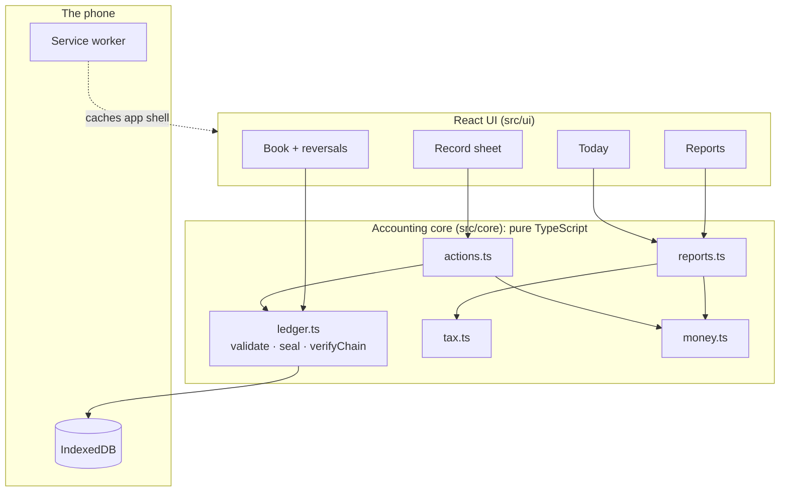

# Case study: Oja Ledger

**Offline, tamper-evident double-entry bookkeeping for Nigerian small businesses.**
Live: [oja-ledger.vercel.app](https://oja-ledger.vercel.app) · Author: [Afolabi Peter](https://www.linkedin.com/in/afolabipeter-dev)

---

## The problem

A provisions seller in a Nigerian market might take 40 payments a day across cash, transfer and POS, sell on credit to regulars, and restock weekly from a depot. At the end of the month she can tell you roughly what came in, but not her profit, how much VAT she owes, or whether she qualifies for the 0% small-company tax rate introduced by the Nigeria Tax Act 2025.

Existing tools assume three things she doesn't have: reliable internet, a laptop, and the vocabulary of an accountant.

**The goal:** books that are correct by construction, kept on a phone, usable with no network, in plain language.

## Decisions and why

### 1. Model it as real double-entry, then hide it
I could have stored "sales" and "expenses" as two lists and summed them. That breaks as soon as you add credit sales, stock, VAT or the owner taking money out, and it can't produce a balance sheet.

Instead every action becomes a journal entry with balanced debit and credit lines over a small chart of accounts. The trader taps **Sale → ₦21,500 → Transfer → includes VAT**, and `actions.ts` produces:

| Account | Debit | Credit |
|---|---|---|
| Bank and POS | ₦21,500.00 | |
| Sales | | ₦20,000.00 |
| VAT collected | | ₦1,500.00 |

The UI never says "debit". The table is there under **What goes in the book** for anyone who wants it, and an accountant can export everything as CSV.

### 2. Integer kobo, never floats
`0.1 + 0.2 === 0.30000000000000004` is a famous JavaScript bug and a disaster in a ledger. Every amount is a whole number of kobo behind a branded `Kobo` type, so TypeScript stops a raw float from sneaking in. VAT is in basis points (750 = 7.5%), and splitting a VAT-inclusive price computes the net and gives the remainder to VAT, so `net + vat === gross` always holds.

### 3. Prove the invariants with property-based tests
Example tests check the cases I thought of. Property-based tests (with [fast-check](https://fast-check.dev)) generate cases I didn't think of. On every push, CI:

- builds **200 random trading histories** of up to 40 entries (sales on credit, VAT purchases, owner drawings, loans, deposits) and asserts the **trial balance balances**;
- asserts **assets = liabilities + equity** on random dates in those histories;
- picks a random entry, **reverses it**, and asserts every account is back exactly where it would be had the entry never happened;
- **tampers** with a random past entry in six different ways and asserts the hash chain catches it;
- round-trips **every amount up to ₦100bn** through format → parse, and checks VAT splitting never creates or loses a kobo.

When a property fails, fast-check shrinks it to the smallest failing case. That's how I found a signed-zero bug in my own reversal test on the first run.

### 4. Make tampering visible with a hash chain
Books are only useful if people trust them. Each entry stores:

```
hash = SHA-256( canonical JSON of { id, seq, date, memo, lines, createdAt, prevHash } )
```

Changing one naira in an old entry changes its hash, which no longer matches the next entry's `prevHash`, so every later link breaks. `verifyChain()` re-computes the whole chain when the app opens. The newest hash and the entry count are also stored separately, so deleting the most recent entry is caught too.

The UI shows the newest hash as a short **fingerprint** (e.g. `a201 21dc 4095`). An accountant who wrote it down at month end can later confirm nothing before it changed.

### 5. Append-only, with reversals
There is no edit and no delete. A mistake is corrected by a **reversal**: a mirror-image entry linked to the original. The original stays visible, crossed out. This is how real accounting systems work, and it keeps the hash chain meaningful. The engine refuses to reverse the same entry twice or to reverse a reversal.

### 6. Offline-first, atomically
The book is stored in IndexedDB on the device. Each save writes the new entries **and** the updated chain head in a single transaction, so a phone dying mid-save leaves either the whole entry or nothing. A test forces a failing save (a duplicate entry number) and checks nothing partial was written. A small service worker caches the app shell, so the app opens with no network once it has been visited.

### 7. Tax rules in one place
`tax.ts` holds the 7.5% VAT rate, the 21st-of-next-month VAT deadline and the small-company limits (≤ ₦50m turnover and ≤ ₦250m fixed assets for 0% company income tax, otherwise 30%). Reports read from there, so a rule change is a one-line edit plus a test update. The app labels these figures as a planning aid, not tax advice.

## Architecture



## Results

- 29 automated tests: 4 property-based ledger invariants at 200 generated ledgers each (plus further property checks on money), and unit tests for parsing, reports, tax edge cases, storage atomicity and two-tab safety
- Strict TypeScript (`strict`, `noUncheckedIndexedAccess`) with no `any`
- Zero runtime dependencies beyond React; fonts are self-hosted so the app works offline
- About 68 kB of JavaScript after gzip

## Known limits

- **Tamper-evident, not tamper-proof.** Someone with access to the device could recompute the whole chain. The fingerprint only protects the owner if it is written down or stored somewhere else.
- **One device is the source of truth.** There is no sync yet.
- **Browsers can clear site storage.** The app asks for persistent storage and tells the owner whether it was granted, but a CSV export is still the real backup.
- **Two tabs:** entry numbers are unique keys, so a second tab saving the same number is rejected whole (the chain cannot fork); the other tab reloads and the user re-enters the entry.

## What I'd build next

- **Sync across devices.** The append-only, hash-linked log is already the right shape for this: devices exchange entries they don't have and the server verifies each chain. Conflicts can't happen because entries are never edited.
- **Encrypted cloud backup** with a key derived from the owner's PIN, so the server never sees the books.
- **Receipt photos and WhatsApp receipts** for customers.
- **Inventory by item**, so cost of goods sold is calculated instead of typed.
- Review of the tax logic by a Nigerian chartered accountant.
